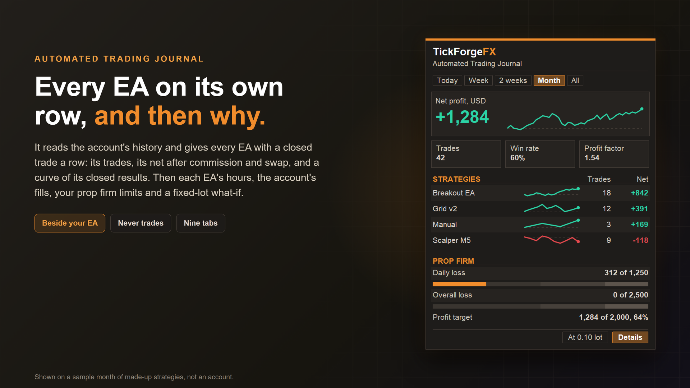

# Automated Trading Journal

An automated trading journal that splits your account by EA, and then answers why. It is an indicator, so it goes on any chart, even beside the EA running there, and it never trades. It reads the account's history and gives every EA with a closed trade a row: its trades, its net after commission and swap, and a curve of its closed results, with manual trades as a row too. Then it shows each EA's hours and sessions, which of your most active EAs lose on the same days, how the account's fills landed against the price asked, where your prop firm limits stand, how an EA's trading compares with its own backtest, and what every trade would have made at one lot size.

**Nothing to type in.** It works from the deals MetaTrader already keeps, so there are no notes, tags or screenshots to add, and no list of single trades on the chart: MetaTrader's own History tab is that list, and the export writes one to a file when you want it in a spreadsheet. What it adds is the split MetaTrader does not make: every result by EA, with each EA's symbols, costs, timing and curves for the period you pick, and where your prop firm limits stand right now.

## Every EA on its own row

- Each magic number is one strategy. Trades placed by hand, on the desktop or in the phone app, carry magic number 0 and show as **Manual**.
- **A trade belongs to the EA that opened it.** MetaTrader stamps a closing deal with the magic number of whatever closed the position, so when a trade manager, a close-all script or your own hand closes an EA's trade, a journal that sorts deals by their own magic number hands that trade to someone else. This one keeps it with the EA that opened it.
- One trade is one position, from open to flat. Partial closes belong to the same trade, and so does a netting add; a netting reversal closes the trade and opens a new one in the new direction.
- Names: the ones you type in **Strategy names**, such as 12345=Breakout. Otherwise the comment at least half of a strategy's trades opened with, otherwise Magic 12345.
- **One strategy on several magic numbers** is joined with a plus in the same input: 777+778=Grid shows both as one row named Grid.
- **Leave a strategy out** by typing its magic number in **Strategies to leave out**, such as 555; 666. Its trades leave the card and every tab but Fills and Prop firm, which always read the whole account, and the card says how many you left out, so a total never passes for the whole account. It goes by each trade's own magic number, so one EA of a group can be left out alone.
- Net is profit plus swap, commission and fees on the trade's own deals. A trade more than half a cent up is a win and more than half a cent down a loss; in between it counts as a trade and as neither.

## The card

- Pick the period: Today, Week, 2 weeks, Month or All, plus a custom range when you set one in the inputs. 2 weeks is today and the 13 days before it. A trade belongs to the period its last exit falls in. Days start at the hour you set, in server time; weeks start on Monday and months on the 1st.
- The period's net profit leads, in the account's currency, with a curve of the account's closed results beside it, and the trades, the win rate and the profit factor in three tiles under it.
- Then your strategies, best first, each with its trades, its net and a small curve of its closed results through the period. When they do not all fit the chart, or there are more than six, they page, with **Next**. On a chart too short for three of them, the three tiles make room first.
- With prop firm rules set, up to three of them sit at the foot of the card, the two loss limits as bars.
- **Details** opens a second card beside it. Drag the card anywhere, or from the inputs lock it in place or pin it to a corner.

## The detail card, nine tabs

Click a strategy on the card and Results, Symbols, Costs, Time and Backtest show that strategy alone; click it again for all of them, or on Backtest for the list of your reports. Together and Curves stay on all the strategies shown, and Fills and Prop firm on the whole account, whichever one you clicked. The **?** at the top of the detail card puts a line on what each figure means in place of the figures, on any tab; click it again for the figures.

- **Results**: the positions open now and their floating result, kept apart from everything closed; trades won and the win rate, net and profit factor; average win and average loss; best and worst trade; the average per trade; the largest fall of the closed-trade curve; what costs took and, when the gross result is a profit, their share of it; the average time a trade was held.
- **Symbols**: each symbol's trades, win rate, net, profit factor and largest fall, the most traded first. When there are more than the table holds, the rest share one row.
- **Costs**: commission (fees included), swap, their total, the cost per lot and, when the gross result is a profit, the share of it they took. One row per strategy for the whole account, one per symbol for a single strategy, and past the table's room the rest share one row. It reports costs; it does not judge your broker.
- **Time**: net by the hour a trade opened, as 24 bars in server time, and four sessions: Asian, London, London and New York, New York. Three inputs set where the sessions change; the defaults suit a server clock of GMT+2 in winter and GMT+3 in summer.
- **Fills**: how far from the price it asked for each fill landed, in points, by symbol: how many filled worse, the average and the worst. It measures fills that kept that price: an exit at a stop loss or take profit, and the entry of a limit or stop order. A market order is not measured: in our tests MetaTrader kept no asked price for one, so no slippage is ever claimed for it.
- **Prop firm**: every limit and objective you set, with the room left. More below.
- **Together**: how your five most active strategies move together, as the correlation of their daily closed results, pair by pair, and which two are most alike. A pair needs at least 10 days on which either of them closed a trade before a number is shown.
- **Curves**: the five most active strategies' closed results through the period, on one time axis, each in its own colour.
- **Backtest**: the strategy you clicked beside the Strategy Tester report you paired with it, rate for rate. More below.

## The fixed-lot what-if

An EA that grows its lot with the account makes its early months look small beside its later ones. The button beside Details, **At 0.10 lot** at the default, puts every trade at one size: its profit, swap and commission scaled by the lot you set in **What-if: every trade at this lot size** over the lot it opened with, and the open positions likewise. The card says so, as "Net profit at 0.10 lot", and every figure and tab follows it except Fills, which counts points, and the prop firm figures, on the card and on the Prop firm tab, which stay as the account traded; the card's prop firm heading says "as traded". Click it again for the account as it traded.

## Export

**Export**, on the detail card, writes the period to three CSV files a spreadsheet opens: one row per strategy, one per symbol, and one per closed trade. They go to MQL5\Files\TickForgeFX, named for the period and the minute you export, and for the lot size when the what-if is on. They hold the strategies the card shows. The detail card's footer says where they went. Nothing leaves your computer.

## The backtest beside its EA

Save a Strategy Tester report as HTML, copy the file into MQL5\Files and pair it with your EA's magic number in **Backtest reports**, such as Breakout.htm=12345; Grid.htm=777, up to six of them. For EAs joined under Strategy names, any of the group's magic numbers will do. Click that EA on the card and the Backtest tab sets its trades in the period you pick beside the whole report, rate for rate: trades a week, the win rate, the profit factor, the average win and loss, the average per trade, costs per lot and the time a trade was held. Money is at each one's own lot; At 0.10 lot puts both at one size. A trade is one position here too, where the report's own Total Trades counts every exit, so its count of trades can be lower than the report's. With no strategy clicked, the tab lists the reports you paired and whether each was read; a report copied in or saved over later is read the next time you click the tab. A report is only used when it is read whole: a row in words it does not know, as a terminal set to another language may write, leaves it out, and the tab says so. A report never enters the account's figures, the prop firm section or the export.

## Prop firm limits: it watches, it never acts

- **Account size**: type it, or leave it at 0 and it is read from the history as the balance the challenge started with. If the history MetaTrader gives does not reach the account's first deposit, the panel asks you to type it rather than guess.
- **Daily loss**, as a percent of the account size, measured from the day's starting balance, its starting equity, the higher of the two, or the day's highest equity. The day starts at your hour and is measured from that moment even if MetaTrader was closed then: what the account booked since counts toward today, and trades open at the reset are valued at that moment's price, read from the chart history.
- **Overall loss**, from the account size, or trailing the highest equity. A deposit buys no extra room. Measured from the size, a payout of profit does not move the line; trailing, the line moves with a deposit or a payout, so cash neither adds room nor takes it.
- **Profit target**, from closed trades, with what is left to go.
- **Trading days**: a day counts when a trade was opened on it, or when a trade was opened or closed on it, whichever your firm uses.
- **Best day**, as a share of the total profit, against your firm's consistency cap. It shows Within or Over once the cap can be met at all, and until then says what it waits for.
- The challenge is taken to start at the latest deposit, withdrawal, bonus or correction of 5% or more of the balance after it, such as the first deposit, a reset or a payout (with none, at the first trade), unless you type a start date. A new start begins the target, the trading days, the best day and the trailing high again, and reads a size left at 0 again, so on a funded account that takes payouts, type the size and the start date.
- The highest equity, of the day or of the challenge, is the highest it has read while running with its panel shown, kept when MetaTrader restarts. For the time it was not, and when the history reaches the account's first deposit, the history adds the balance at every moment the account held no open trade, when equity and balance were the same. A high reached while a trade was open and the journal was off is not seen, so keep it running if your firm measures from a high.
- Credit your broker adds is left out of every figure.

It never closes a trade at a limit. If you want a limit enforced, our Daily Loss and Drawdown Risk Manager closes trades at the line you set.

## Beside your EAs

It is an indicator, so it shares a chart with your EA: put it on the chart your EA runs on, or on any other. It reads the account's whole history, so every trade shows up whichever chart, terminal or phone placed it, and one copy covers the account. MetaTrader lets no indicator place a trade, so it cannot touch your EAs' trades.

## About the demo, stated plainly

On this market a paid product's demo runs only in the Strategy Tester, and a tester account starts with no trades, so there is nothing of yours to read there. So in a **visual** test it shows a **sample month**: three made-up strategies and a few manual trades, with a sample prop firm challenge beside them, moved to end within the seven days up to the day your test starts. Every period, row and tab works on it as it would on your account, the what-if included, though the strategies, their names, the challenge with its readings and the backtest report beside Breakout EA are the sample's own: **Strategy names** and **Strategies to leave out** change nothing there. The cards say it is a sample: the detail card's footer reads "A sample month, not an account". It is the same month the screenshots show. For your own EAs, attach it to your account.

## What it is not

- Not a journal you write in: no notes, tags, screenshots, ratings or calendar.
- Not a trade list on the chart: MetaTrader's History tab has every deal, and the export writes the closed trades to a file.
- Not a risk manager or a trade manager: it is an indicator, and MetaTrader lets no indicator open, change or close a trade.
- Not a forecast: it measures what has happened and what is open now, and predicts nothing. The what-if rescales what happened; it does not say what will.

## Good to know

- Hedging and netting accounts, both.
- One copy per chart: a second copy added to the same chart stays idle, and the card says a second journal is waiting until you remove one.
- It reads the whole history when attached, again when your balance or open positions change, and once a minute in any case.
- Every figure is in server time, the clock MetaTrader stamps every deal with.
- Commission a broker bills as a separate account entry, rather than on the trade's own deals, is in the prop firm figures but in no strategy's net.
- If your broker has trimmed old history, a trade whose opening deal is gone goes to whatever closed it, each of its exits counted as a trade of its own, and the detail card's footer says that some opening deals are missing when such a trade is among those shown.

## If you need me, I answer

Ask in the comments or by MQL5 message and you get a reply from me, not a support desk. If something is broken I want to know about it, and a bug report gets a fix rather than a workaround.

Your history already says which of your EAs is earning its place. This shows you why.

---

Current version: **1.0**, on MetaTrader 5

On the MQL5 Market:

- MetaTrader 5: [Automated Trading Journal](https://www.mql5.com/en/market/product/206115)
