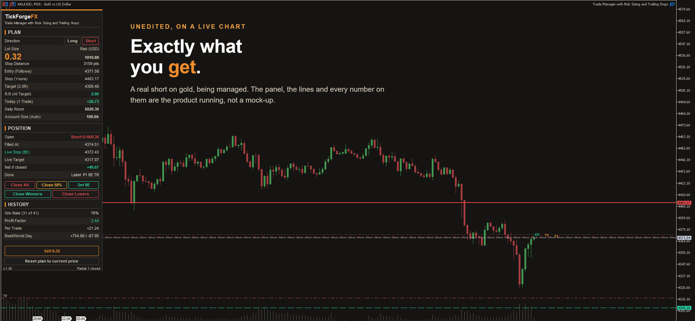
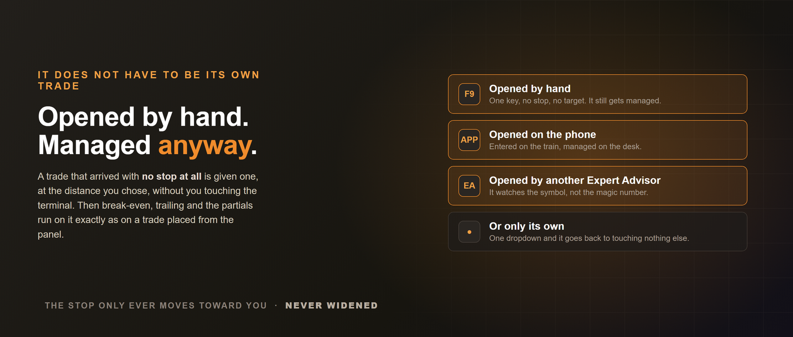

# Trade Manager with Risk Sizing and Trailing Stops

**Risk-sized entry, break-even, partial closes, a trailing stop and a daily loss limit, in one panel for MetaTrader 5.** Drag your stop to where the trade is wrong and the lot size follows your risk. Its button sends the order at that size. Then it manages the trade on every tick, whether you opened it from the panel, by hand, from the phone or with another EA, and it stops you for the day when your loss limit is reached.

It never decides to trade. There are no signals and no strategy in it. You choose the direction and the levels; it does the arithmetic, places the order and runs your rules.

## Four tools you would otherwise run side by side

- **A position size calculator.** Lot size for the percent you risk, money at risk, stop distance and reward-to-risk, recomputing as you drag.
- **An order panel.** The button names what it is about to send, for example "Buy 0.06": a market order, or, once the entry is set not to follow price, the right pending order for where you put the entry line.
- **A trade manager.** Break-even with up to two more lock steps, three partial closes and four trailing modes.
- **A loss limit that acts.** Daily and overall limits that close the trades it opened and refuse new entries when they are reached.

One panel, one set of settings, and nothing to copy from one tool into another.

## Size it, then send it

- Drag the stop anywhere along its line and the lot size recomputes, so one percent is one percent whether the stop sits ten points away or two hundred.
- Risk as a percent of balance or of equity, or of a fixed account size you type, so a good week does not quietly grow your position size.
- Prefer a rule to a drag? Put the stop a fixed number of points or an ATR multiple behind price, and lock the target to a reward-to-risk multiple so it follows.
- A second click confirms before anything is sent, on by default. The confirmation expires on its own and is cancelled the moment you move a line.
- Your plan is saved per symbol, so a timeframe change or a restart never quietly rebuilds it from wherever price happens to be.

## Then it manages the trade, on every tick

- **Break-even** at your trigger, locking a buffer beyond entry rather than exactly on it, then up to two further steps that lock more as the trade runs.
- **Three partial closes**, each taken from what is left rather than from the original size. The third arrives switched off.
- **Four trailing modes**: a fixed distance, an ATR multiple, Chandelier below the highest high since entry, or behind the last N closed candles.
- **Triggers in points, ATR multiples, R multiples or your account currency**, whichever suits how you trade.
- **Every trade on the symbol**, however it got there: from this panel, with F9, from the phone app or by another EA. One dropdown limits it to only the trades it opened.
- **A trade with no stop** can be given one at your planned distance, measured from that trade's own open price. Off until you switch it on.
- **Alerts when it acts**: a popup, a sound, a push to the MetaTrader mobile app or an email, and the chart is marked at the price it happened.

## Five buttons for when you want out

As soon as a position exists the card shows Close All, Close 50%, Set BE, Close Winners and Close Losers. Each one asks for a second click before it acts, which you can switch off, and each reports what it did, including when the honest answer is that there was nothing to close.

## The day it matters: a loss limit that acts

- Set a daily and an overall limit as a percent of your account. The panel shows the room you have left before either one is reached.
- On a breach it cancels its working orders, closes the trades it opened and refuses new entries. Closing trades it did not open is a separate switch, off until you turn it on, and it needs Manage set to every trade on the symbol.
- The daily reset hour is yours to set in server time, so the day rolls when your prop firm says it does rather than at midnight.
- The overall limit measures from the highest equity the account has reached by default, so it protects what you have made and not only what you deposited.
- A withdrawal is not treated as a trading loss, and a deposit does not widen your limits.

## What it refuses to do

- It refuses to size a bad plan. Put the stop a hair from the entry and it prints two dashes and tells you the stop is too tight to size, instead of handing back a confident oversized lot.
- It never widens a stop. Not in any trailing mode, not after a partial, not across a restart.
- A button that cannot fire tells you why: market closed, trading disabled, daily limit reached, not enough free margin, stop too close to the current price.
- It sizes a stop with the loss value your broker uses, which on many CFDs and crosses differs from the profit value, so it does not quietly risk more than you asked for.

## Good to know

- Works on netting and hedging accounts, on any symbol your broker offers.
- It manages the symbol of the chart it is on, and only that. Put it on each chart you trade.
- It is an Expert Advisor, and MetaTrader runs one Expert Advisor per chart. To use it beside another EA on the same symbol, attach it to a second chart of that symbol and set Manage to "Only trades this tool opened", so it leaves that EA's trades to that EA.
- Every stage fires at most once per position, and that memory survives a restart, a recompile and a change of ticket.
- A partial needs a position big enough to split. On a symbol whose smallest tradable size is 0.01, Partial 1 needs 0.02 or more.
- On a trade that arrived with no stop, the ATR, Chandelier and candle trails can set its first stop on the losing side of entry, where the volatility or the structure puts it. Break-even, the extra lock steps and the fixed-distance trail never do.
- An optional history section shows win rate, profit factor, average per trade and your best and worst day, read from your broker's own closed deals.
- Partials, break-even, trailing, the target line, the alerts and the account limits can each be switched off. With all of them off it is simply a risk-sized entry panel.

## About the demo

On this market a paid product's demo runs only in the Strategy Tester. You can place a trade from the panel there and watch break-even, the partial closes and the trailing stop run as the test advances. MetaTrader sends no mouse events to an Expert Advisor in a test, so the lines cannot be dragged there: set the stop in Points or ATR mode instead. Alerts cannot be delivered in the tester, but each event still shows in the panel footer, on the chart and in the log. In a non-visual run on a netting account funded under 2000, which is how this market's automated check runs it, it opens minimum-lot sample trades by itself and says so in the journal. In a visual run it never trades unless you press a button.

## If you need me, I answer

Ask in the comments or by MQL5 message and you get a reply from the person who wrote the code, not a support desk. A bug report gets a fix rather than a workaround.

Built by TickForgeFX.

---

Current version: **1.60**

On the MQL5 Market: [Trade Manager with Risk Sizing and Trailing Stops](https://www.mql5.com/en/market/product/189281)
