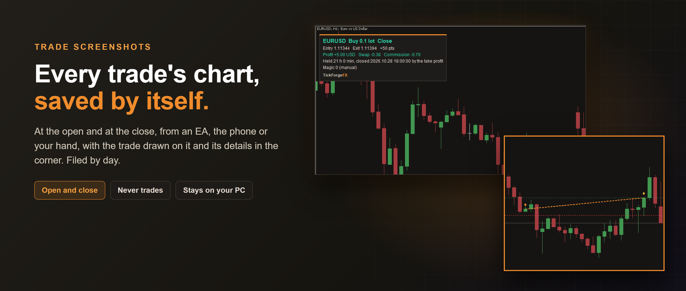

# Trade Screenshots at Entry and Exit

Every trade's chart, saved by itself. Each time a trade opens or closes on your account, from an EA, the phone or
your own hand, this MetaTrader 5 indicator saves a picture of that symbol's chart with the trade drawn on it and its
details written in the corner, filed by day, with a page for each day you open in your browser. It never places,
changes or closes a trade, and the pictures stay on your PC.

## Why a picture

MetaTrader's History tab tells you a trade lost 40 dollars. It does not show you what the chart looked like when you
went in, or where price went before it came out. A journal of pictures does, and keeping one by hand means remembering
a screenshot at the worst possible moment. This takes them for you, for every trade, including the ones your EA takes
at 3 in the morning while MetaTrader runs.

## When it takes them

- **At the open**, a second or two after the fill, so a stop and a target your EA sets right after it are on the picture.
- **At the close**, straight away, with the line from entry to exit drawn.
- **At a partial close**, marked with how much of how much, such as 0.01 of 0.02.
- **On a netting account**, an add is a picture of its own, and a reversal is a close and an open.
- **When you press Take a picture now** on its card, of the chart it sits on.

## What is on each picture

- The chart as you keep it: your timeframe, your template, your other indicators. One picture for every chart of the
  symbol you have open, one per timeframe.
- The trade drawn on it: the entry, the stop and the target, and on a close the exit and the line from entry to exit.
- A card in the corner you choose: the symbol, buy or sell, the lot size, the prices, the time, what opened or closed
  it, the magic number and the comment; on a close, the points, the profit and swap, the commission and fees with
  their share of what was charged at the open, and the time it was held.
- 1280 x 720 by default, or 1600 x 900 or 1920 x 1080, whatever size your chart window is.

## Where they go

Into the terminal's own folder (**File, Open Data Folder, MQL5, Files, TickForgeFX Trade Screenshots**), then your
account number and one folder per day. Each day has a page, **Trades.html**, with every trade of the day, newest first,
its details and its pictures. Nothing is uploaded or sent anywhere.

When no chart of the symbol is open, it opens one for a moment, hands the front straight back, takes the picture once
the chart has loaded and closes it again. A trade that closed while MetaTrader was off is caught up the next time it
starts and marked **Captured late**.

## What it is not

- Not a trade manager: it is an indicator, and MetaTrader lets no indicator open, change or close a trade.
- Not a sender: no Telegram, no e-mail, no web.
- Not statistics: no totals, no win rate, no calendar. For the numbers per EA, see
  [Trading Journal for EAs and Prop Firms](https://www.mql5.com/en/market/product/200565).

---

Current version: **1.0**, on MetaTrader 5, free

On the MQL5 Market:

- MetaTrader 5: [Trade Screenshots at Entry and Exit](https://www.mql5.com/en/market/product/204774)
