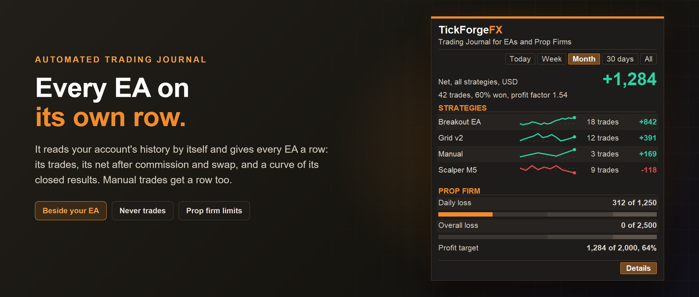

# Trading Journal for EAs and Prop Firms

An automated trading journal that splits your account by EA. It is a MetaTrader 5 indicator, so it goes on any chart,
even beside the EA running there. It reads the account's history and gives every EA with a closed trade a row: its
trades, its net after commission and swap, and a curve of its closed results, with manual trades as a row too. Set
your prop firm's rules and it shows the room left before each limit. It never trades.

## Nothing to type in

It works from the deals MetaTrader already keeps, so there are no notes, tags or screenshots to add, and no list of
single trades: MetaTrader's own History tab is that list. What it adds is the split MetaTrader does not make: every
result by EA, with each EA's symbols, costs, timing and curves for the period you pick, and where your prop firm
limits stand right now.

## Every EA on its own row

- Each magic number is one strategy; trades placed by hand show as **Manual**.
- **A trade belongs to the EA that opened it.** MetaTrader stamps a closing deal with the magic number of whatever
  closed the position, so a journal that sorts deals by their own magic number hands a trade closed by a trade manager,
  a close-all script or your own hand to someone else. This one keeps it with the EA that opened it.
- One trade is one position, from open to flat: partial closes and netting adds belong to it.
- Net is profit plus swap, commission and fees.

## The card and its eight tabs

The small card leads with the period's net (Today, Week, Month, 30 days, All, or a custom range) and lists your
strategies best first, each with its own curve. **Details** opens a second card:

- **Results**: open positions and their floating result, kept apart; won, net, profit factor, average win and loss,
  best and worst trade, the average per trade, the largest fall, costs and time held.
- **Symbols**: each symbol's trades, win rate, net, profit factor and largest fall.
- **Costs**: commission, swap, total, per lot and the share of the gross result they took.
- **Time**: net by the hour a trade opened, and four sessions, in server time.
- **Fills**: how far from the price it asked for each fill landed, for fills that kept it: stops, targets, and limit
  and stop orders. A market order is not measured: in our tests MetaTrader kept no asked price for one.
- **Prop firm**: daily loss (from the day's starting balance, starting equity, the higher, or the day's high), overall
  loss (from the size, where a payout of profit does not move the line, or trailing, where the line moves with cash),
  the room left under each; and the profit target, trading days and the best-day cap. It watches; it never acts.
- **Together**: how your most active strategies' daily results move together.
- **Curves**: their closed results through the period, on one axis.

## The demo

A paid product's demo runs only in the Strategy Tester, where an account starts with no trades. So in a visual test it
shows a sample month: three made-up strategies and a few manual trades, with a sample prop firm challenge beside them.
Every period, row and tab works on it (the names and the challenge's rules are the sample's own), and the cards say it
is a sample.

## What it is not

Not a journal you write in, not a trade list, not a trade or risk manager (MetaTrader lets no indicator trade), and
not a forecast: it measures, it does not predict.

---

Current version: **1.0**, on MetaTrader 5

On the MQL5 Market:

- MetaTrader 5: [Trading Journal for EAs and Prop Firms](https://www.mql5.com/en/market/product/200565)
